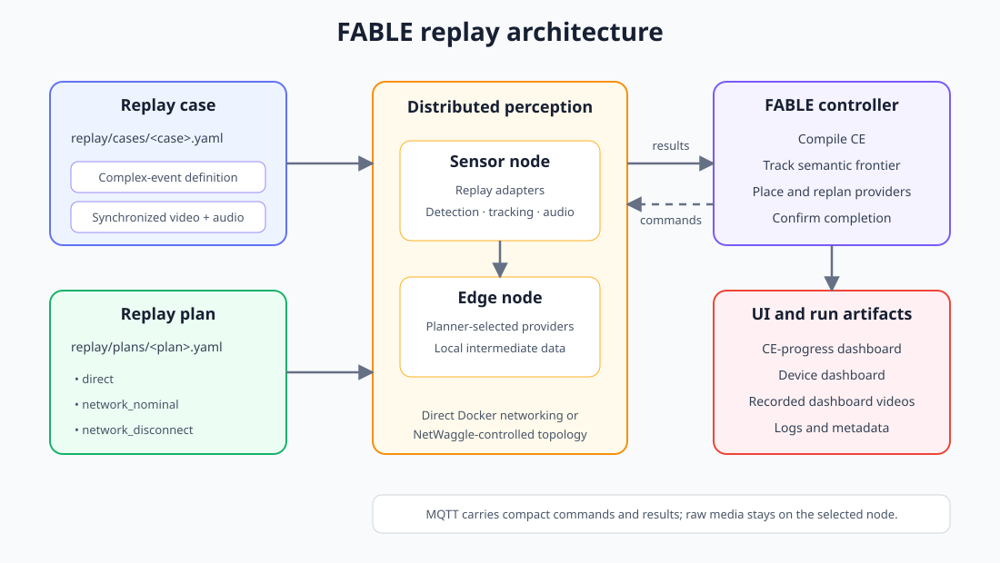

# FABLE

FABLE detects complex events in recorded IoBT camera and audio data while
adapting perception placement to changing network conditions.

It combines four pieces:

1. A complex-event language and runtime.
2. Video/audio replay synchronized by event time.
3. Distributed perception providers running on sensor and edge nodes.
4. NetWaggle network conditions such as disconnects and bandwidth limits.

## Run it

### One-time setup

Requirements:

- Python 3.11+
- Docker with Compose
- NVIDIA Container Toolkit and a CUDA-capable GPU
- FFmpeg
- the NetWaggle/Mininet host setup described in
  [netwaggle/README.md](netwaggle/README.md), only for `network_nominal` and
  `network_disconnect`

Install FABLE:

```bash
python -m venv .venv
.venv/bin/pip install -e ".[distributed,vision,audio]"
cp .env.example .env
```

Edit `.env` and set the two recording locations:

```dotenv
RECORDING_ROOT=/path/to/mobile-recordings
GQ_RECORDING_ROOT=/path/to/fixed-camera-recordings
```

The recordings are external data and are not stored in this repository.

### Two-terminal workflow

Terminal 1 starts the persistent broker, controller, agents, and dashboards:

```bash
./run stack
```

Terminal 2 starts a synchronized replay experiment:

```bash
./run --case convoy1 --plan network_nominal
```

That is the nominal workflow. The stack remains running so additional cases can
be started without rebuilding it.

Useful variants:

```bash
./run --list
./run --case convoy1 --plan direct
./run --case convoy1 --plan network_disconnect
./run --case vehicle_convergence1 --plan network_nominal
./run --case convoy1 --plan network_nominal --dry-run
./run status
./run stop
```

The dashboards are served at <http://localhost:5000>. Each completed run saves
the device dashboard, CE-progress dashboard, combined dashboard video, logs,
metadata, and progress images under `.fable/runs/`.

## Case versus network plan

Every command selects exactly two configuration files:

```bash
./run --case CASE --plan NETWORK_PLAN
```

### 1. Case: what is replayed and detected

A case is one self-contained YAML file under [`replay/cases`](replay/cases).
It contains both:

- the complex-event definition; and
- the synchronized video/audio replay sources.

For example, everything specific to `convoy1` is in
[`replay/cases/convoy1.yaml`](replay/cases/convoy1.yaml):

```yaml
case_id: convoy1
event:
  event: route_convoy
  roles: ...
  pattern: ...
replay:
  replay_id: 20241008-route-convoy-1-r012
  speed: 1.0
  source_policy: ...
  sources: ...
```

The `event` block says what FABLE should detect. The `replay` block defines
every fixed camera, mobile recording, audio file, timestamp, segment, rotation,
and inference source. There is no separate case catalog, event file, or
event-specific experiment file.

Paths beginning with `/recordings` come from `RECORDING_ROOT`. Paths beginning
with `/gq-recordings` come from `GQ_RECORDING_ROOT`. Docker mounts those host
directories read-only.

### 2. Network plan: where and how it plays

Network plans are reusable across every case and live beside the cases under
[`replay/plans`](replay/plans):

| Plan | Execution method |
|---|---|
| `direct` | Ordinary Docker host networking; NetWaggle is not started. |
| `network_nominal` | NetWaggle sensor/edge topology with no injected impairment. |
| `network_disconnect` | The same NetWaggle topology with `sensor_edge_uplink` disconnected. |

Thus these commands replay the identical `convoy1` case three ways:

```bash
./run --case convoy1 --plan direct
./run --case convoy1 --plan network_nominal
./run --case convoy1 --plan network_disconnect
```

Here, `--plan` selects a network plan. It is separate from FABLE's internal
execution plan, which dynamically assigns perception providers to nodes.

### Configure another case

1. Copy an existing file under `replay/cases/`.
2. Replace its `event` block with the CE to detect.
3. Replace its `replay` block with the synchronized recording sources.
4. Run it with any existing network plan:

   ```bash
   ./run --case NEW_CASE --plan direct --dry-run
   ./run --case NEW_CASE --plan network_nominal --dry-run
   ```

No network-plan file should contain a case or event name. Add a new file under
`replay/plans/` only when a genuinely new reusable network condition is
needed.

## Replay inputs

Replay is based on the media type, not the device that recorded it.

- Fixed-camera and mobile-phone video use the same OpenCV video adapter.
- Sideways phone video can declare a 90, 180, or 270 degree rotation.
- Split phone recordings can be joined as one logical camera.
- Audio is replayed from mono PCM WAV files.
- Audio embedded in phone video must currently be extracted to WAV first.
- GPS and other generic phone telemetry are not currently replay inputs.

All sources share an event-time clock and one replay-release barrier, allowing
fixed cameras, phone cameras, and extracted audio to remain synchronized.
Reviewed, self-contained inputs are under [replay/cases](replay/cases).

## Repository layout

```text
fable/       core CE language, providers, planner, runtime, execution, and UI
replay/      self-contained cases and replay adapters
netwaggle/   network topology and condition control
deployment/ Docker files, broker settings, workers, and deployment configuration
scripts/     command implementations used by ./run
docs/        architecture and historical notes
```

Root files:

- `run` is the friendly experiment and stack launcher.
- `pyproject.toml` tells Python how to install FABLE and its dependencies.
- `.env` contains machine-local recording paths and is ignored by Git.
- `.fable/` contains generated run output and is ignored by Git.

## What `run` does

`./run stack` starts the long-lived Docker Compose services. A case command
loads one self-contained case from `replay/cases/`, loads one reusable network
plan from `replay/plans/`, releases all replay sources together, and records
the dashboards.

The underlying Python entry points remain in `scripts/` as implementation
details, but ordinary use should go through `./run`.

## Architecture

```text
event YAML
  -> CE compiler and candidate frontiers
  -> provider selection and sensor/edge placement
  -> node-local video/audio perception dataflow
  -> predicate and identity results
  -> CE progress or completion
```

Raw media and provider intermediates remain on the selected node. MQTT carries
compact commands and event results rather than raw sensor streams.



## License

FABLE is available under the [MIT License](LICENSE).
